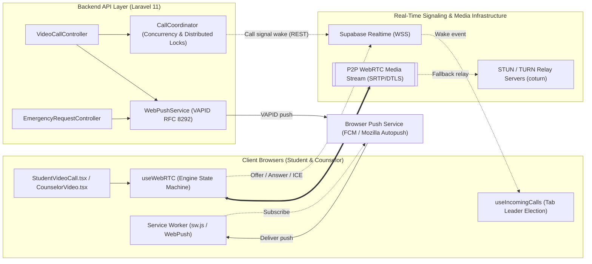
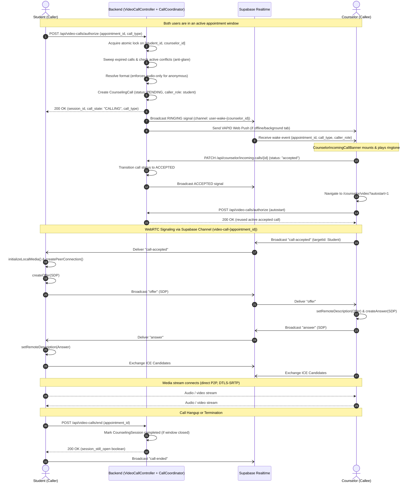
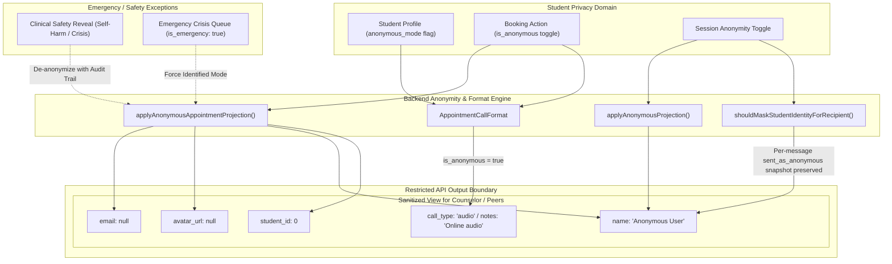
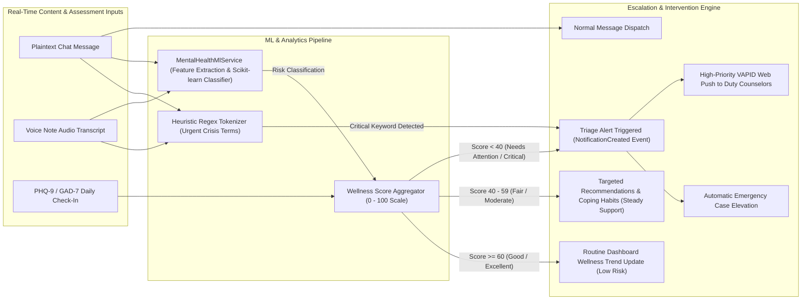

# Mindful AU — System Architecture & Component Diagrams

This document outlines the end-to-end architecture of **Mindful AU**, a secure mental health counseling and teletherapy platform comprising a React/TypeScript single-page application, a Laravel 11 API backend, Supabase Realtime signaling, peer-to-peer WebRTC media streaming, and an ML wellness scoring & crisis-detection pipeline.

**Legend (diagrams 1a and 1b):** solid arrow = synchronous REST / direct call · dashed arrow = async, signaling or push · thick double arrow = peer-to-peer media.

---

## 1a. System Architecture (Clients → API → Data)

Portal routing nodes (Student App / Counselor App) stand in for all REST calls made by each portal. Real-time signaling and push delivery are in diagram 1b.

```mermaid
flowchart LR
    subgraph Clients["Frontend Client Layer (React 18 + Vite + Tailwind)"]
        subgraph StudentUI["Student Portal"]
            SP_App["Student App / Routing"]
            SP_Chat["Chat & E2E Crypto"]
            SP_Video["StudentVideoCall.tsx"]
            SP_Appt["StudentAppointments.tsx"]
            SP_Panic["Emergency / Panic Request"]
        end

        subgraph CounselorUI["Counselor & Staff Portal"]
            CP_App["Counselor App / Routing"]
            CP_Chat["Supervised Chat & Roster"]
            CP_Video["CounselorVideo.tsx"]
            CP_Schedule["Slot Management"]
            CP_Alerts["Crisis & Triage Alerts"]
        end

        subgraph ClientCommon["Shared Client Infrastructure"]
            SW["Service Worker (sw.js / WebPush)"]
            Hook_Calls["useIncomingCalls (Tab Leader Election)"]
        end
    end

    subgraph Backend["Backend API Layer (Laravel 11 / PHP 8.2)"]
        subgraph Gateways["API Routing & Middleware"]
            AuthMid["Sanctum Auth & 2FA Middleware"]
            CorsMid["CORS & Role Gatekeeper"]
        end

        subgraph CoreControllers["Core Controllers"]
            ApptCtrl["AppointmentController"]
            VideoCtrl["VideoCallController"]
            CallInCtrl["Counselor / Student IncomingCallController"]
            SessCtrl["SessionController"]
            MsgCtrl["MessageController"]
            ProfCtrl["ProfileController"]
            EmergCtrl["EmergencyRequestController"]
        end

        subgraph SupportServices["Domain Coordinators & Services"]
            CallCoord["CallCoordinator (Concurrency & Distributed Locks)"]
            CallFormat["AppointmentCallFormat & Window Manager"]
            WebPushSvc["WebPushService (VAPID RFC 8292)"]
            ML_Svc["MentalHealthMlService (Crisis & Wellness Analysis)"]
        end
    end

    subgraph DataStorage["Data & Persistence Tier"]
        DB[("Primary Database: MySQL (prod) / SQLite (dev)")]
        CacheStorage["Analytics & Distributed Cache (File / Redis)"]
        FileStore["Encrypted Storage (Voice Notes & Attachments)"]
    end

    subgraph ExternalServices["External Cloud & Push Services"]
        GoogleOAuth["Google OAuth 2.0 (SSO)"]
        WebPushGateway["Browser Push Service (FCM / Mozilla Autopush)"]
    end

    %% Clients -> API
    SP_App --> AuthMid
    CP_App --> AuthMid
    Hook_Calls --> AuthMid
    SW --> AuthMid
    SP_App -. "OAuth Login" .-> GoogleOAuth

    %% Middleware chain
    AuthMid --> CorsMid
    CorsMid --> ApptCtrl
    CorsMid --> VideoCtrl
    CorsMid --> CallInCtrl
    CorsMid --> SessCtrl
    CorsMid --> MsgCtrl
    CorsMid --> ProfCtrl
    CorsMid --> EmergCtrl

    %% Controllers -> services
    ApptCtrl --> CallFormat
    VideoCtrl --> CallCoord
    VideoCtrl --> CallFormat
    VideoCtrl --> WebPushSvc
    CallInCtrl --> CallCoord
    MsgCtrl --> ML_Svc
    EmergCtrl --> WebPushSvc

    %% Persistence
    ApptCtrl & VideoCtrl & CallInCtrl & SessCtrl & MsgCtrl & ProfCtrl & EmergCtrl --> DB
    CallCoord & ML_Svc --> CacheStorage
    MsgCtrl --> FileStore

    %% Push out to external gateway
    WebPushSvc --> WebPushGateway
```

---

## 1b. Real-Time Call, Signaling & Push Flow

---

## 2. Voice & Video Call Orchestration (WebRTC + Realtime Ringing)

This sequence diagram depicts call initiation, lock acquisition, concurrent ring resolution, peer wake-up, and WebRTC media establishment.

---

## 3. Privacy, Anonymity & Data Boundary Isolation

Mindful AU enforces strict anonymity boundaries between students and counselors. This diagram demonstrates how data projections isolate student PII at the API and database levels.

---

## 4. ML Wellness Scoring & Crisis Detection Pipeline

